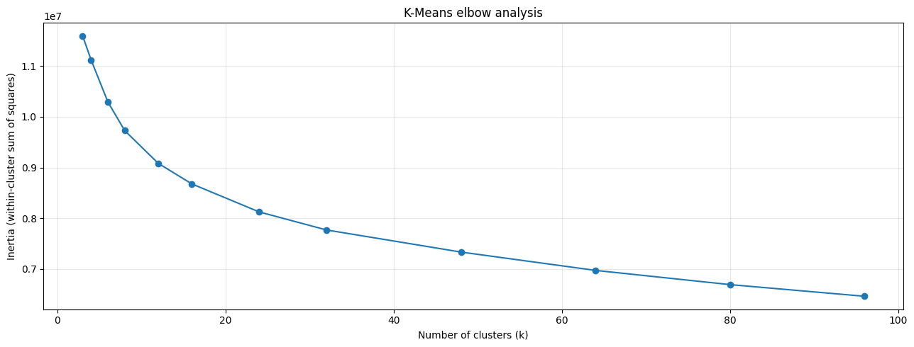

## The Short Version

An academic exploratory analysis of a slice-localization bio-dataset with **53,500 observations and 384 numerical input features**. The goal was to investigate groups of similar feature vectors, rather than predict the reference variable or recover patient identities.

After removing 64 duplicate feature vectors, I grouped strongly correlated features into composites, reducing the representation to **261 features across 53,436 observations**. I compared K-Means partitions using silhouette scores, inertia, membership counts, and PCA projections, then selected a **nine-cluster working partition** for descriptive profiling.

The separation was weak. This project documents an exploratory workflow and its trade-offs; it does not establish distinct clinical populations.

## Problem

How can high-dimensional, anonymously named biological features be grouped without letting identifiers, scale differences, or repeated measurements dominate the result?

The supplied data contained a patient identifier, features named `value0` through `value383`, and a `reference` variable. Limited feature descriptions meant that numerical differences could be described, but biological meanings could not be assigned confidently.

## Approach

**Input preparation** — Excluded the patient identifier and reference variable from clustering. Deduplicated using the 384 input features alone, then fitted a standard scaler to the retained observations.

**Correlation-based feature aggregation** — Calculated pairwise Spearman correlations for nonconstant features. Complete-linkage hierarchical clustering used `1 - correlation` as the feature-distance measure, with a threshold of 0.20. This grouped strongly positively correlated features without merging strongly negative relationships.

Each multi-feature group was replaced by the row-wise mean of its standardized members. A `feature_mapping` dictionary retained the link to the original columns. The resulting 261 features were standardized again so that each nonconstant composite or retained feature had unit variance. This changes feature weighting deliberately; it is **not PCA**.

**K-Means comparisons** — Tested a broad set of cluster counts from 3 to 96, followed by every count from 5 to 25. Models used `random_state=42` and three initializations. The recorded silhouette calculations used the full reduced dataset rather than a sample.

**Diagnostics and visualization** — Compared inertia and silhouette scores, inspected a detailed silhouette plot for the 25-cluster candidate, and examined membership counts and two- and three-dimensional PCA views for 9, 10, and 17 clusters. PCA was used for visualization; K-Means was fitted in the 261-feature space.

<figure>
  
  <figcaption>The broad inertia search. Inertia falls as more clusters are added; the curve supports inspection of diminishing returns rather than proving a unique cluster count.</figcaption>
</figure>

**Cluster profiles** — Compared cluster means against the overall feature means, expressed in dataset-standard-deviation units. Selected the 29 largest absolute deviations per cluster and built a table showing features selected in multiple profiles. These are descriptive differences, not causal effects or predictive feature importances.

**Reusable tooling** — Used my MAna package for data-loading, clustering-evaluation, and visualization helpers alongside scikit-learn and SciPy.

## Results

| Candidate | Recorded silhouette | Interpretation |
| --- | --- | --- |
| 3 clusters | 0.101 | Highest score in the broad search |
| 9 clusters | 0.092 | Selected finer-grained working partition; highest score in the 5–25 search |
| 10 clusters | 0.087 | Nearby comparison |
| 17 clusters | 0.081 | Finer partition with weaker separation |

Nine clusters offered a finer partition near the gradual inertia bend around 8–12 clusters, but **did not outperform three clusters on silhouette**. All of these scores indicate substantial overlap under the chosen representation and distance measure.

The final model exported original-scale feature values and nine-cluster labels for the **53,436 deduplicated observations**. The export excludes patient identifiers, reference values, the removed duplicates, and the original row index; reliable downstream joins would require retaining a row identifier separately.

## What I Learned

Feature aggregation is a modeling choice about how variables influence distance, not just a way to shrink a table. Keeping a mapping to the original inputs makes composites traceable, but does not prove that correlated features mean the same thing.

Likewise, choosing a useful level of detail is different from declaring an optimal number of natural groups. The higher score at three clusters remains part of the result even though I used nine for profile inspection.

## Limitations and Next Steps

- The analysis does not report a controlled comparison against an equivalent unaggregated baseline, so improvement from aggregation is not established.
- A fixed seed supports reproducibility, but stability across seeds and alternative preprocessing choices was not assessed.
- Scaling and evaluation used the available dataset; held-out patient generalization was not tested.
- Anonymous features and weak separation limit substantive or clinical interpretation. PCA views provide visual context rather than validation.

Useful next checks would compare representations, measure stability, and test whether the numerical profiles relate to meaningful external information excluded from fitting.

## Links

- [Read the notebook on Kaggle]({{ page.kaggle }})
