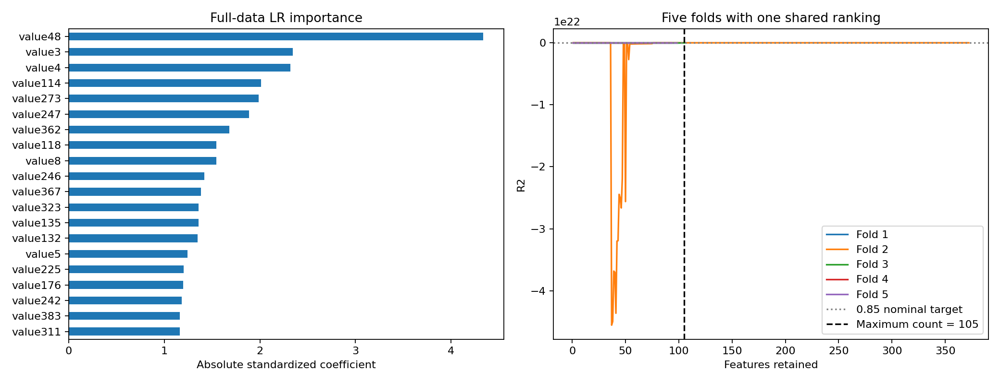

## The Short Version

How much can I reduce the input space before prediction suffers? This exploratory study compares **Pearson grouping, Spearman grouping, PCA, PLS, and coefficient-based feature selection**, using ordinary linear regression as the common prediction model.

The slice-localization dataset starts with **53,500 rows and 384 predictors**, plus patient identity and a numeric `reference` target. Cleaning leaves **53,437 rows and 372 predictors**. On the common validation split, **10 PLS components achieved R² 0.85687**, compared with **0.86191** for the full-feature baseline: a **97.31% reduction in representation dimensions** with an absolute R² drop of approximately **0.00505**.

Those are exploratory validation results, not a claim of patient-level generalization. Fewer components also do not automatically mean fewer original measurements are needed.

## Problem

Different reduction methods preserve different things. Correlation grouping combines related inputs, PCA preserves input variance, PLS uses the target to find predictive directions, and feature selection retains original columns.

I used prediction of `reference` to compare how much **linear predictive performance** each representation retained. R² is target-specific; it does not measure all information in the dataset. Patient identity stayed outside the predictors, and the anonymous feature names limited interpretation of their physical meaning.

This follows my [exploratory bio-feature clustering project](/projects/ml-exploratory-clustering-bio-features/), shifting the question from finding groups of observations to comparing reduced feature representations.

## Approach

**Audit and cleaning** — Checked constants, duplicate columns, missing and infinite values, and sampled matrix conditioning. Removed five constant predictors, six additional duplicate predictors, and one almost-constant predictor. Row deduplication removed 63 rows before column removal. These full-data audit decisions make the evaluation exploratory.

**Common baseline** — Used an 80/20 random row split with seed 42. Standard scaling was fitted on training rows only, while the target remained in its original units. Ordinary linear regression was refitted for each representation, with R², MAE, and RMSE evaluated on the same validation rows.

**Pearson and Spearman grouping** — Used MAna's complete-linkage correlation grouping at a positive-correlation threshold of 0.75. Groups became means of standardized members; original-feature mappings made the composites traceable. The two methods produced 273 and 236 dimensions respectively.

**PCA** — Retained at least 95% of training input variance, producing 212 components. Preserving variance is a different objective from preserving predictive R².

**PLS** — Fitted 10 target-informed components on the training split, followed by the same linear-regression model. A separate five-fold diagnostic refitted scaling and PLS within each fold.

**Original-feature selection** — Ranked absolute standardized OLS coefficients using the full cleaned dataset, then added original predictors in that shared order within five folds. The rule sought R² that rounds to at least 0.85. Successful folds needed 100, 105, 93, and 98 predictors; one fold failed. The maximum successful count, **105**, became the selected subset. Because ranking used all targets, subsequent validation scores are not independent of selection.

## Recorded Results

| Representation | Dimensions | Validation R² | MAE | RMSE | Dimension reduction |
| --- | ---: | ---: | ---: | ---: | ---: |
| Full-feature OLS baseline | 372 | 0.86191 | 6.09436 | 8.26991 | 0% |
| Pearson grouping | 273 | 0.85698 | 6.22457 | 8.41638 | 26.61% |
| Spearman grouping | 236 | 0.84816 | 6.44428 | 8.67208 | 36.56% |
| PCA | 212 | 0.85419 | 6.27148 | 8.49799 | 43.01% |
| PLS | 10 | 0.85687 | 6.23124 | 8.41966 | 97.31% |
| Original-feature selection | 105 | 0.84815 | 6.36641 | 8.67233 | 71.77% |

PLS supplied the smallest representation meeting the experiment's rounded target. Pearson grouping retained slightly higher R² than PLS, while the full-feature baseline had the highest score overall.

The rounding rule matters: **0.84815 rounds to 0.85 but is below an unrounded 0.85 threshold**. The table reports the actual scores rather than treating rounding as proof of equivalent performance.

## Numerical Failures Were Part of the Result

One baseline fold in the PLS diagnostic was unstable: two predictors matched in its training rows but differed in a validation row, and large opposing OLS coefficients led to an extreme prediction. The reported filtered diagnostic used four of five folds and retained the raw failed-fold results. Its average is conditional on those exclusions and may be optimistic.

The separate original-feature-selection experiment also had a failure: at 105 selected predictors, fold 2 produced **R² approximately −1.13 × 10¹⁸**, while the other four folds were around 0.845–0.851. The subset therefore did not meet the target reliably across all five folds.

<figure>
  
  <figcaption>The saved selection diagnostic. The extreme failed-fold values dominate the right-hand axis; they remain visible rather than being hidden by an average.</figcaption>
</figure>

## Outputs and Lessons

The workflow exports reduced datasets with source-row identity, split labels, patient identity, and target metadata, plus representation mappings and model parameters. Metadata must stay outside the predictor matrix when those files are reused. MAna supplied loading, cleaning, correlation grouping, coefficient plotting, and regression evaluation.

The key distinction is **smaller representations versus fewer measurements**. PCA and PLS components can still require all 372 cleaned inputs. Selecting 105 original columns addresses a different practical constraint, but its shared full-data ranking and unstable fold prevent a strong generalization claim.

## Limitations and Next Steps

- Cleaning decisions used the full dataset, and validation was reused for method and setting choices; there is no untouched final test estimate.
- Random row splitting allows the same patient in training and validation. Performance on unseen patients is not established.
- Full-data target-informed feature ranking leaks selection information into the later validation folds.
- Filtered fold summaries do not resolve numerical instability or replace reporting all attempted folds.

A stronger follow-up would fit filtering and selection inside training folds, separate patients across splits, investigate conditioning, and reserve a final test set. These results compare the recorded exploratory workflows rather than establish a universally best reduction method.

## Links

- [Explore the notebook on Kaggle]({{ page.kaggle }})
- [Related: Exploratory Clustering of Bio-Features](/projects/ml-exploratory-clustering-bio-features/)
